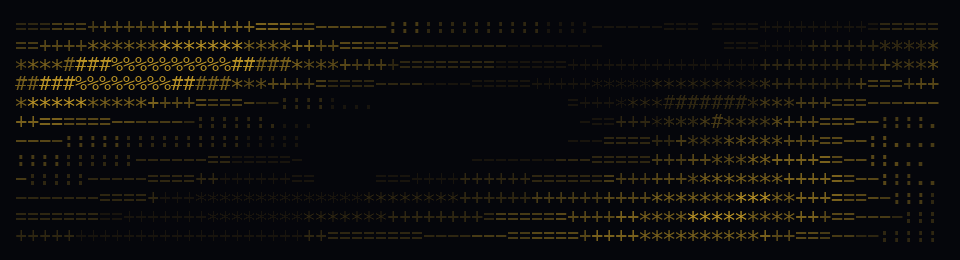

  

hi! i'm amaan. i'm building at the intersection of ai, autonomous systems, and startups. here you'll find some of the projects i've worked on and things i'm currently building.

currently building [hyperfleets.ai](https://hyperfleets.ai) — an autonomous operating system for fleets.

#### my codex usage across devices

<table width="100%">
  <thead>
    <tr>
      <th align="left" width="18%">stat</th>
      <th align="left" width="36%">value</th>
      <th align="right" width="46%">tokens over time</th>
    </tr>
  </thead>
  <tbody>
    <tr>
      <td width="18%">lifetime tokens</td>
      <td width="36%">Not connected</td>
      <td rowspan="6" width="46%" valign="middle" align="center">
        Codex usage chart
        
Awaiting usage data

      </td>
    </tr>
    <tr>
      <td>est. API cost</td>
      <td>Not connected</td>
    </tr>
    <tr>
      <td>current streak</td>
      <td>Not connected</td>
    </tr>
    <tr>
      <td>daily history</td>
      <td>Not connected</td>
    </tr>
    <tr>
      <td>history tokens</td>
      <td>Not connected</td>
    </tr>
    <tr>
      <td>updated</td>
      <td>Not connected</td>
    </tr>
  </tbody>
</table>
